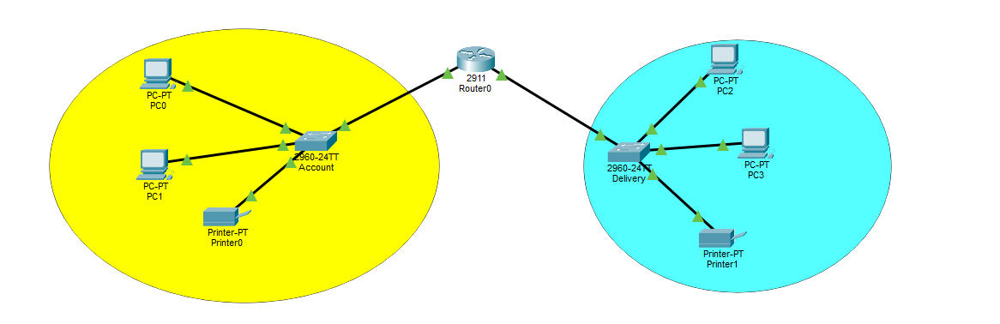
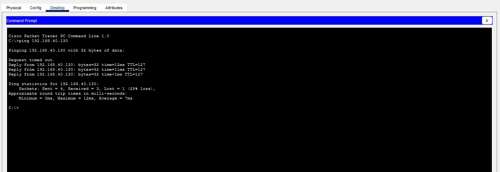

# ACCOUNTS and DELIVERY Network (Cisco Packet Tracer)

A network connecting the ACCOUNTS and DELIVERY departments using
routers and switches, built in Cisco Packet Tracer.

## Requirements
- Each department has at least 2 PCs
- Network address: 192.168.40.0
- All devices connected with appropriate cables
- DELIVERY PCs can ping ACCOUNTS PCs

## Topology

## Addressing Table
| Department | Network        | Mask            | Gateway       |
|------------|----------------|-----------------|---------------|
| ACCOUNTS   | 192.168.40.0/25  | 255.255.255.128 | 192.168.40.1  |
| DELIVERY   | 192.168.40.128/25 | 255.255.255.128 | 192.168.40.129 |

## Devices Used
- 2 PCs per department
- 2 switches
- 1 router (or 2, depending on your design)

## Connectivity Test

## How to Open
Open `accounts-delivery-network.pkt` with Cisco Packet Tracer.